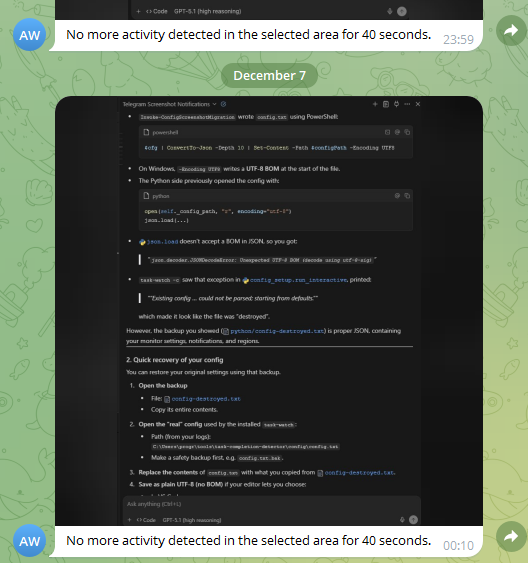

# task-completion-detector
Get notified when your AI coding assistant needs you. Never miss a task completion or required input again.

**Two monitoring modes:**
- **task-watch** – Notify when a region becomes **stable** (no activity for X seconds)
- **change-watch** – Notify when a region **changes**, confirmed by two consecutive checks (useful for watching static indicators like pause buttons)

When monitoring starts, enabled Telegram/email channels receive a brief confirmation explaining when you'll hear back: after a period without activity, or when the watched area changes. Telegram also includes a screenshot of the watched area for visual verification. See [startup confirmation](docs/USAGE.md#startup-confirmation) for details.

## 🚀 Quick Install

### macOS

Copy and run in your terminal:

```bash
ORIGINAL_DIR=$(pwd)
mkdir -p /tmp/task-detector-setup && cd /tmp/task-detector-setup
curl -sO https://raw.githubusercontent.com/Sokrates1989/task-completion-detector/main/setup/macos.sh
bash macos.sh
cd "$ORIGINAL_DIR"
rm -rf /tmp/task-detector-setup
```

### Windows

Copy and run in PowerShell (as Administrator for best results):

```powershell
$OriginalDir = Get-Location
$TempDir = "$env:TEMP\task-detector-setup"
New-Item -ItemType Directory -Path $TempDir -Force | Out-Null
Set-Location $TempDir
Invoke-WebRequest -Uri "https://raw.githubusercontent.com/Sokrates1989/task-completion-detector/main/setup/windows.ps1" -OutFile "windows.ps1"
Set-ExecutionPolicy -ExecutionPolicy Bypass -Scope Process -Force
.\windows.ps1
Set-Location $OriginalDir
Remove-Item -Recurse -Force $TempDir
```

## 📖 Quick usage

For all commands and detailed behavior, see `docs/USAGE.md`.

### task-watch – stability mode

**macOS (Terminal)**

```bash
task-watch --select-region [name]   # select & watch region (aliases: --select, -r, -s; also saves under default name)
task-watch [name]                   # watch named region (or default when omitted)
task-watch --config                 # open config wizard (monitor thresholds, notifications)
task-watch --update                 # update to latest version (git clone only)
```

**Windows (PowerShell, after install)**

```powershell
task-watch -r [name]                # select & watch region (also -s, -SelectRegion; also saves under default name)
task-watch [name]                   # watch named region (or default when omitted)
task-watch -c                       # open config wizard (also -Config)
task-watch -u                       # update to latest version (also -Update; git clone only)
```

### change-watch – change mode

**macOS (Terminal)**

```bash
change-watch --select-region [name] # select & watch region for changes (aliases: --select, -r, -s)
change-watch [name]                 # watch named region for changes (or default when omitted)
```

**Windows (PowerShell, after install)**

```powershell
change-watch -r [name]              # select & watch region for changes (also -s, -SelectRegion)
change-watch [name]                 # watch named region for changes (or default when omitted)
```

### Desktop shortcuts

- **macOS:** Double-click `task-watch.command` on your Desktop
- **Windows:** Double-click `task-watch.lnk` on your Desktop

**Aliases:**
- `change-watch` – same as `task-watch --change` (watch for changes)
- `ai-select` – same as `task-watch --select-region` (legacy, macOS)
- `ai-watch` – same as `task-watch` (legacy, macOS)

### Telegram notifications

When Telegram notifications are enabled in the config, the tool sends a chat message **and** a screenshot of the monitored area:

- In `task-watch` (stability mode), the screenshot shows the region once it has become stable.
- In `change-watch` (change mode), the screenshot combines the "before" and "after" views side by side for easier comparison.

Example Telegram notification:



## 📚 More docs

- **Installation & configuration details:** `docs/INSTALL.md`
- **Usage, behavior & Telegram setup:** `docs/USAGE.md`

## 💻 Supported Platforms

- **macOS** (tested) - Uses `osascript` for native notifications
- **Windows** (tested) - Uses PowerShell toast notifications (optionally via BurntToast module)
